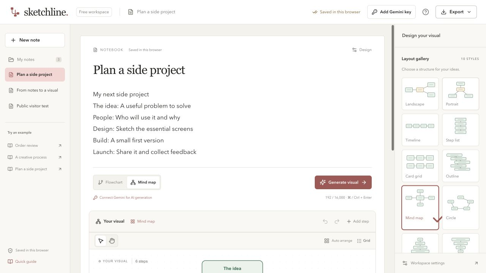

# Sketchline

Write notes, turn them into an editable flowchart or mind map, then move cards, rewrite labels, and reshape connections on the same paper page.



Sketchline is an independent application inspired by text-to-diagram workflows. It does not call Napkin’s private APIs or use its branding, templates, or artwork.

## Features

- Notebook pages with in-place diagram generation and a notes library.
- Flowcharts and mind maps, with a local generator that works without a key.
- Visitor-supplied Google AI Studio keys, a Gemini model selector, and model discovery directly from Google.
- Ten layouts: Landscape, Portrait, Timeline, Step list, Card grid, Outline, Mind map, Circle, Pyramid, and Funnel.
- Editable labels, shapes, descriptions, themes, cards, line bends, and arrow endpoints.
- Undo/redo, browser saving, and PNG, SVG, and editable Sketchline JSON exports.
- Responsive note navigation and design panels.

## Run locally

Requires Node.js **22.x** and npm.

```sh
npm ci
npm run dev:public
```

Open the address printed by Vite. Write notes, choose Flowchart or Mind map, click Generate visual, then Use this visual. Drag cards and lines to edit the result. Double-click a label to change it.

For Gemini generation, click **Add Gemini key**, paste your own key, and connect. Choose a Gemini model in that same dialog. Google’s model access, quota, and any charges apply to that key.

## Deploy on Vercel

Import the repository into Vercel. Select the directory containing `package.json` and `vercel.json` as the project root. The included configuration sets:

| Setting | Value |
| --- | --- |
| Framework | Vite |
| Install command | `npm ci` |
| Build command | `npm run build:public` |
| Output directory | `dist-public` |
| Node.js | 22.x |
| API key environment variables | None required |

Each visitor enters their own Gemini key in the app. This repository does not contain an owner API key. A Vercel deployment has not been created by the initial repository publication.

See [the Vercel guide](docs/VERCEL.md) for deployment instructions and [the public version guide](docs/PUBLIC-VERSION.md) for storage and key handling.

## Key handling and privacy

Keys stay in page memory by default. Refreshing clears the key. Remember for this tab is optional and uses session storage; Disconnect removes it. Browser session restoration may restore tab storage. Keys are excluded from diagram saves and exports.

The browser sends a connected visitor’s key and notes directly to Google for model discovery/generation. The key is an `x-goog-api-key` header, never a URL parameter. The app uses no analytics or remote runtime scripts. Model selection is a separate, non-secret browser preference.

Hosted notes are stored in that browser/profile, without cloud synchronization or accounts. People using the same browser profile share its saved notes. Export a Sketchline backup before clearing site data or changing devices/domains.

See [SECURITY.md](SECURITY.md) for the security model, audit scope, and reporting guidance.

## Build and test

```sh
npm test
npm run build:public
npm run verify:public
```

The public build ignores local environment files and checks the output for private files, credential patterns, symbolic links, and missing compiled assets. No heuristic scanner can establish that a project has no security flaws; keep credentials out of source and review changes before publishing.

## Optional private Mac server

```sh
npm run dev
```

This version runs at `http://127.0.0.1:4317` and can save notes in a local `data/` folder. It can read an optional locally created `.env` containing `AI_PROVIDER=gemini`, `GEMINI_API_KEY`, and `GEMINI_MODEL`. OpenAI remains an optional server adapter. Environment files and local data are ignored by Git. The private server is not deployed to Vercel.

To run the private production version, use `npm run build` followed by `npm start`.

## Structure

| Path | Purpose |
| --- | --- |
| `src/` | React notebook, React Flow editor, key/model settings, layout, and export |
| `shared/` | Diagram validation, examples, local parser, and Gemini JSON request format |
| `server/` | Optional loopback-only storage and server-side AI adapters |
| `scripts/check-public-build.mjs` | Static build output checks |
| `tests/` | Generation, storage, layout, connection, export, and deployment checks |
| `vercel.json` | Public Vite build and response headers |

The app supports up to 40 nodes per visual and 16,000 source characters. The local generator is a basic parser; review AI labels and relationships before accepting a visual. PNG is a flat image; a Sketchline JSON export preserves the editable document. There are no shared accounts, cloud sync, real-time collaboration, or server-side user key storage.

Built with React, React Flow, Dagre, GSAP, Sonner, Lucide, and Vite. Their licenses remain with their respective packages. [How it works](docs/HOW-IT-WORKS.md) explains the diagram data model and editing pipeline.
